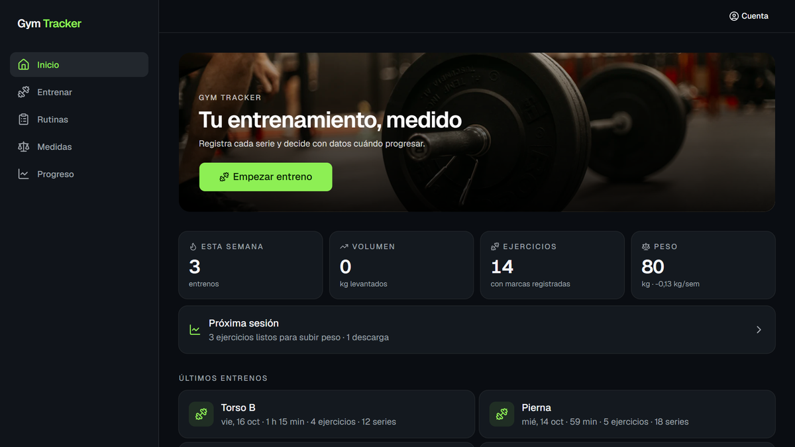
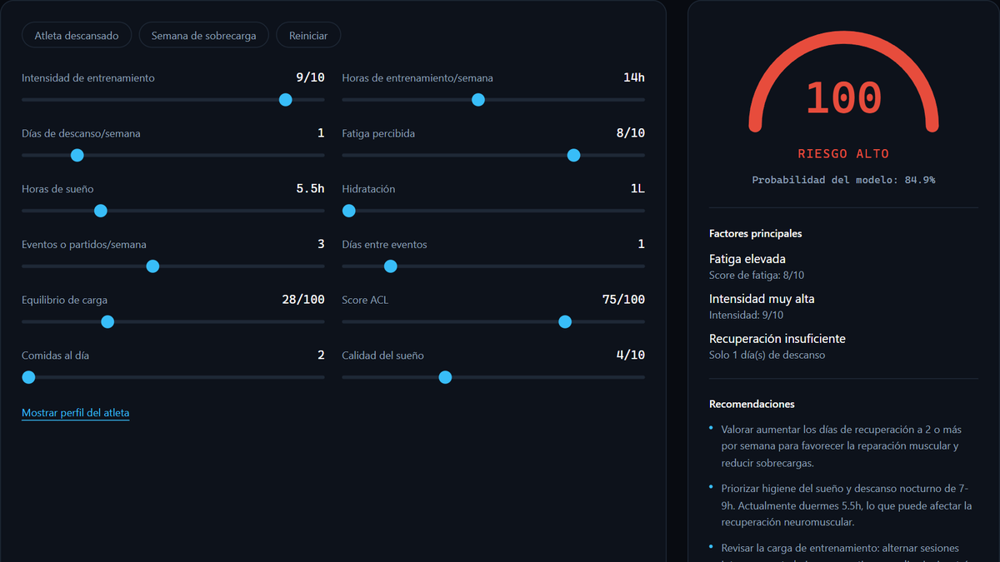
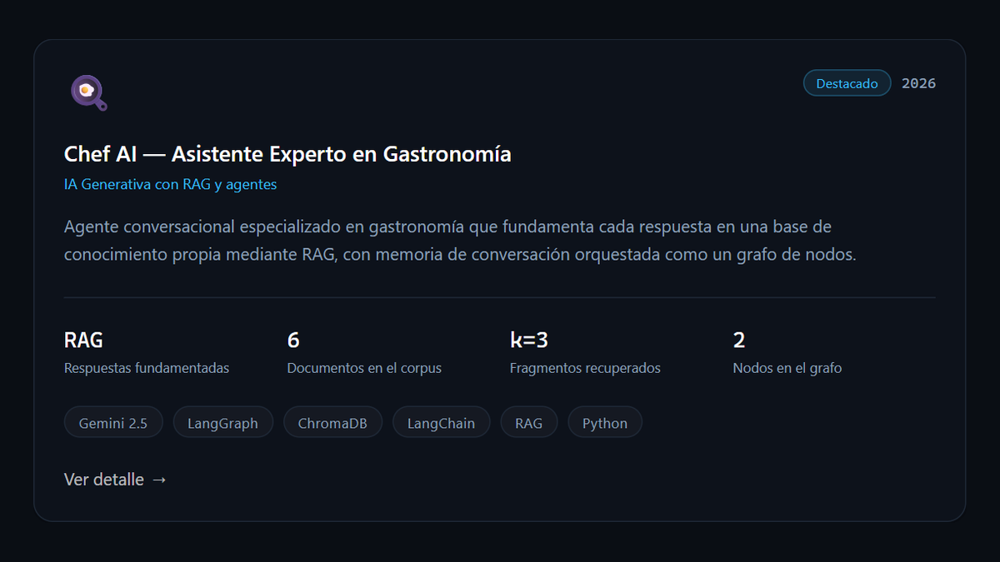
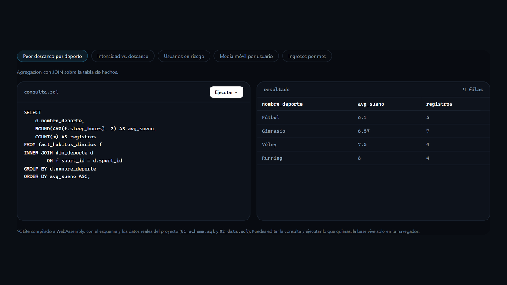
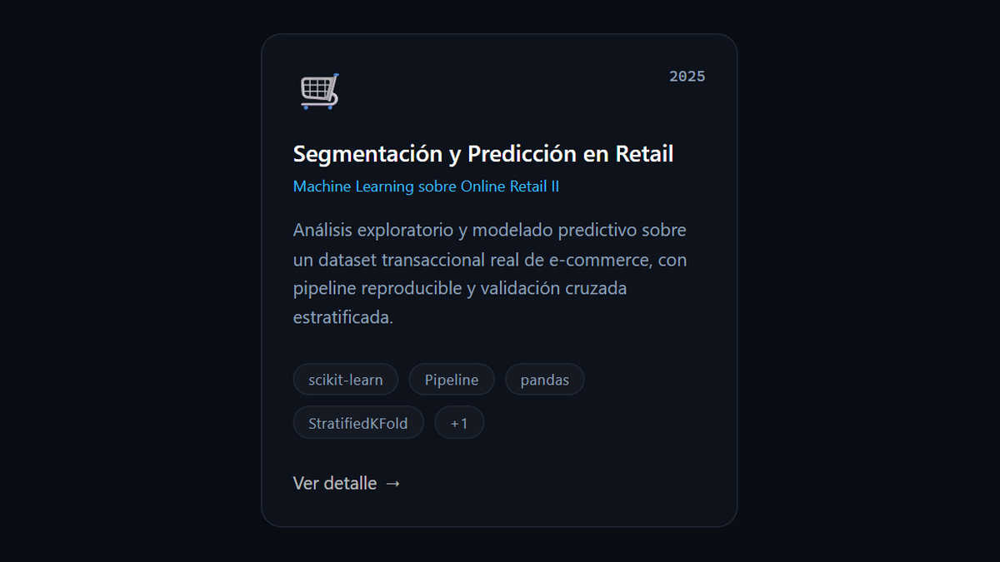
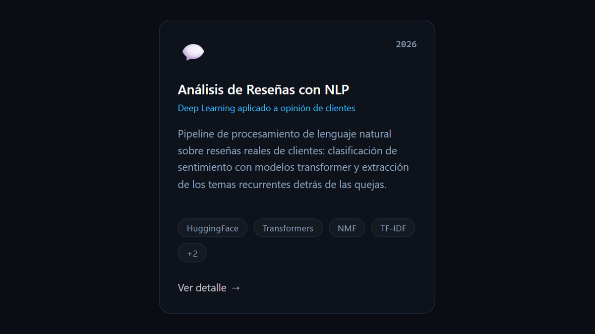

  
  
  

### Sobre mí

Soy de Sevilla y trabajo con datos y desarrollo web. Estudié el ciclo de Desarrollo de Aplicaciones Web y después hice dos másteres, uno de Big Data e IA en Medac y otro de Data Science e IA en Evolve.

En mi último trabajo, en Four Stack, llevaba los datos de unos 100 clientes. Muchos procesos se hacían a mano y tardaban dos o tres días por cliente, así que fui automatizándolos con Python hasta dejarlos en menos de uno. Antes estuve en Engranajes Ciencia haciendo el front-end de su plataforma con React.

Ahora mismo estoy buscando trabajo como analista de datos o desarrollador Python.

### Con qué trabajo

  

  
  
  
  
  
  
  

### Proyectos

<table>
<tr>
<td width="50%" valign="top">

**Gym Tracker**

Una app para gestionar rutinas de gimnasio y crear rutinas adaptadas a cada usuario según sus datos. Con cada entreno analiza el progreso y te dice cuándo subir peso.

React · TypeScript · FastAPI · PostgreSQL · Docker · GitHub Actions

[Código](https://github.com/danialco9/gym-tracker) · [Probar la demo](https://gym-tracker-two-beta.vercel.app)

</td>
<td width="50%" valign="top">

**Predicción de riesgo de lesión**

Mi TFM. Un modelo con XGBoost que estima el riesgo de lesión de un deportista según cómo entrena, duerme y come. Lo pasé a JavaScript y se puede probar en el navegador.

Python · XGBoost · scikit-learn · Streamlit

[Código](https://github.com/danialco9/proyecto-final) · [Probar la demo](https://danialco9.vercel.app/#demos)

</td>
</tr>
<tr>
<td width="50%" valign="top">

**Asistente de cocina con IA**

Un asistente que responde preguntas de cocina buscando en sus propios documentos (RAG) y recuerda la conversación gracias a un grafo de agentes.

Python · Gemini · LangChain · LangGraph · ChromaDB

[Código](https://github.com/danialco9/asistente-experto)

</td>
<td width="50%" valign="top">

**Base de datos de hábitos saludables**

Diseño y consultas de una base de datos sobre hábitos de jóvenes deportistas. En el portfolio se pueden lanzar las consultas contra la base real.

SQL · PostgreSQL · SQLite · Modelo en estrella

[Código](https://github.com/danialco9/proyecto-sql) · [Probar la demo](https://danialco9.vercel.app/#demos)

</td>
</tr>
<tr>
<td width="50%" valign="top">

**Ventas de una tienda online**

Análisis de un millón de ventas y un modelo para predecir qué clientes vuelven a comprar.

Python · Pandas · scikit-learn

[Código](https://github.com/danialco9/proyecto-machine-learning)

</td>
<td width="50%" valign="top">

**Reseñas de clientes con NLP**

Qué opinan los clientes de Boohoo y de qué se quejan, comparado con otras tiendas de moda.

Python · Transformers · TF-IDF · NMF

[Código](https://github.com/danialco9/proyecto-deep-learning)

</td>
</tr>
</table>

El resto de proyectos del máster están en mi portfolio: <a href="https://danialco9.vercel.app">danialco9.vercel.app</a>

